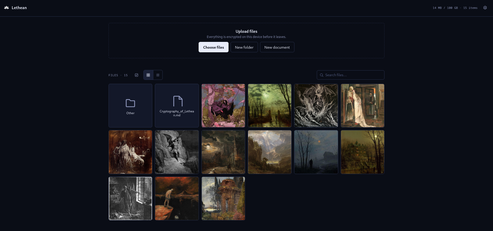
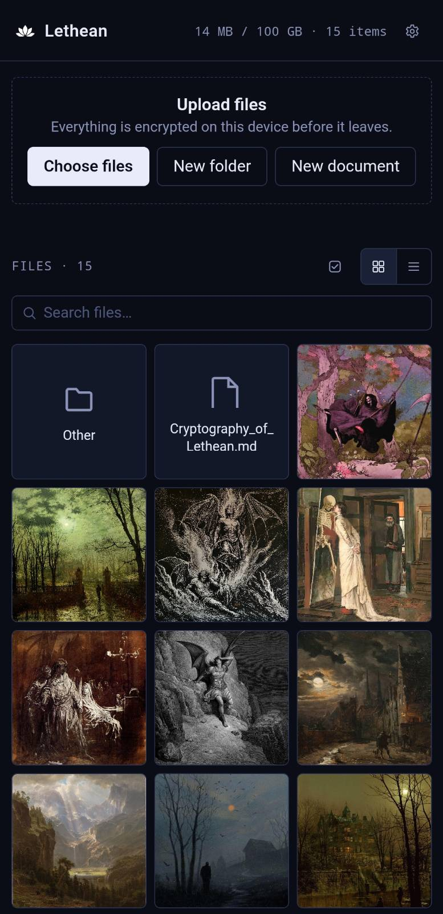

<div align="center">


## Zero-Knowledge Encrypted Cloud Storage

</div>

Lethean is an account-free, end-to-end encrypted file vault. A vault is opened with a user-chosen password and an operator-issued access token. All encryption happens on the client, and the server stores only ciphertext, wrapped keys and opaque identifiers.

> The name refers to the **Lethe**, the river of forgetfulness in Greek mythology: souls who drank from it lost all memory of their previous lives.

## Features

- AES-256-GCM with a random key per item; Argon2id key derivation
- Size hiding through fixed padding buckets for content and metadata
- Authenticated chunking for large files, with resumable uploads and streaming decryption
- Duress code that wipes the vault and opens an indistinguishable decoy
- Expiring, download-limited share links
- Web, desktop and mobile (Tauri) and Linux FUSE clients
- Built-in Markdown editor and in-browser previews
- Optional admin panel for tokens and share links

<table align="center">
<tr>
<td align="center"><br/><sub>Desktop</sub></td>
<td align="center"><br/><sub>Mobile</sub></td>
</tr>
</table>

## Design

The client derives a master key from the password with Argon2id, salted with a hash of the access token. HKDF-SHA256 splits the master key into two keys:

- a **vault ID**, sent to the server as a bearer credential;
- a **wrapping key**, which never leaves the client.

Each file and folder has its own random key, wrapped under the wrapping key. Files up to 32 MiB are sealed as one message; larger files are sealed in 32 MiB chunks bound to their position, so tampering, reordering and truncation are detected.

See [`CRYPTOGRAPHY.md`](CRYPTOGRAPHY.md) for the full specification and threat analysis.

## Server

```bash
git clone https://github.com/umutcamliyurt/Lethean.git
cd Lethean/client && npm install && npm run build

cd ../server
python3.13 -m venv .venv && source .venv/bin/activate
pip install -r requirements.txt
uvicorn main:app
```

The API and web client are served on port 8000. Production deployments must use HTTPS. Vaults are opened with operator-issued access tokens, created with `python manage_tokens.py create`.

See [`SERVER.md`](SERVER.md) for access tokens, the reverse proxy, all configuration variables, the admin panel and the data the server stores.

## Clients

**Desktop and mobile** (requires Rust):

```bash
scripts/setup-tauri.sh && scripts/setup-tauri-android.sh
cd client
npm run tauri:build            # desktop
npm run tauri:android:build    # Android
```

**FUSE (Linux)** (requires Rust and `libfuse3-dev`):

```bash
cd lethean_fuse && cargo build --release
lethean-fuse config set-server https://vault.example.com
lethean-fuse config set-token
lethean-fuse mount ~/Vault
```

The mount is accessible only to its owner and root. Provide the token with `config set-token` or `LETHEAN_ACCESS_TOKEN`, not on the command line. Also available: `tree`, `usage`, `rotate-password`, `upgrade`, `share`, `unshare` and `duress`.

Native clients connect only to `https://` servers (`http://` is permitted on loopback).

## Upgrading Legacy Vaults

Items created before format 2 remain readable but are less resistant to a malicious server. **Settings → Upgrade Vault** (or `lethean-fuse upgrade`) re-encrypts them and verifies each copy before deleting the original. Existing share links to upgraded items stop working. Update every client before upgrading.

## Threat Model

| | Threat | Notes |
|:-:|---|---|
| ✅ | Stolen server data | Only padded ciphertext and wrapped keys are stored; Argon2id slows password guessing |
| ✅ | File metadata | Names, types, folder structure and exact sizes are encrypted or padded |
| ✅ | Network observers | Passwords and keys are never transmitted |
| ✅ | Coerced unlock | The duress code wipes the vault and opens a decoy that looks like a normal unlock |
| ✅ | Malicious server (desktop, mobile, FUSE) | Client code ships with the build; tampered data fails authentication |
| ✅ | Other local users (FUSE) | The mount, its disk buffers and the stored token are private to the owner |
| ❌ | Malicious server (web app, share links) | The server delivers the JavaScript and could capture keys |
| ❌ | Server denial of service | The server can withhold or delete files, but cannot read them |
| ❌ | Compromised device | Malware, a malicious browser extension or root access can read decrypted data |
| ❌ | Weak passwords | Strength checks enforce a minimum, but a guessable password is still guessable |
| ❌ | Traffic analysis | The server sees timing, access patterns and padded size buckets |

Details are in [`CRYPTOGRAPHY.md`](CRYPTOGRAPHY.md#14-threat-analysis). Report vulnerabilities as described in [`SECURITY.md`](SECURITY.md).

## License

Distributed under the **MIT License**. See [`LICENSE`](LICENSE) for full terms.